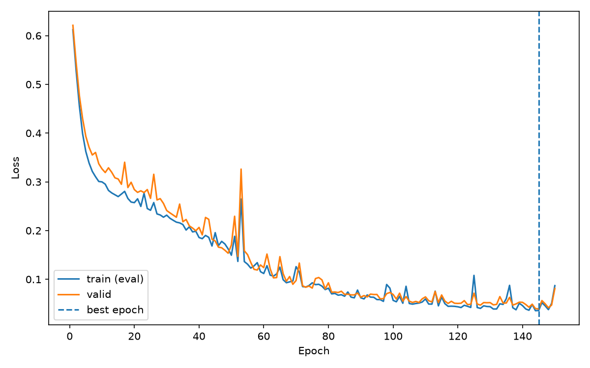
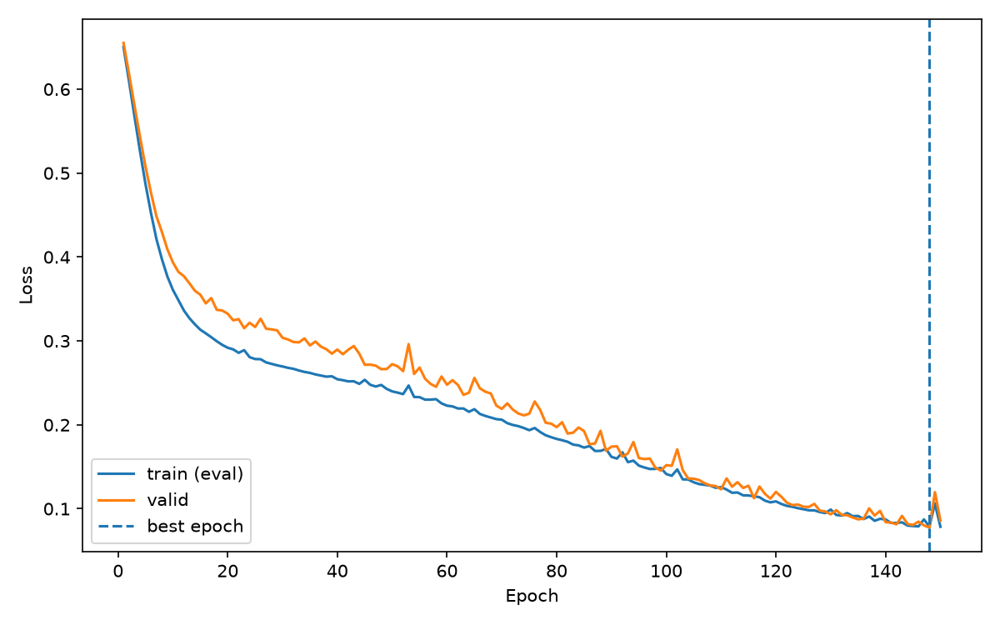
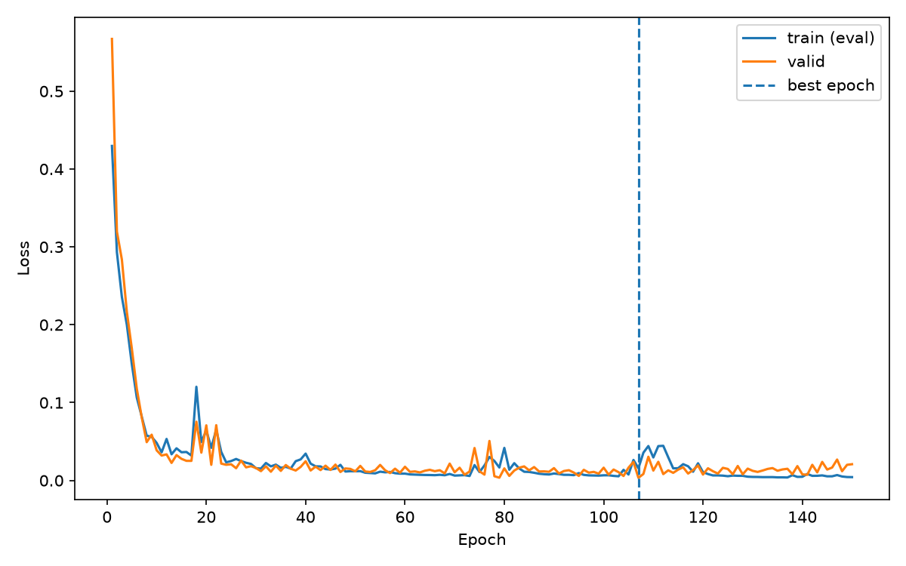
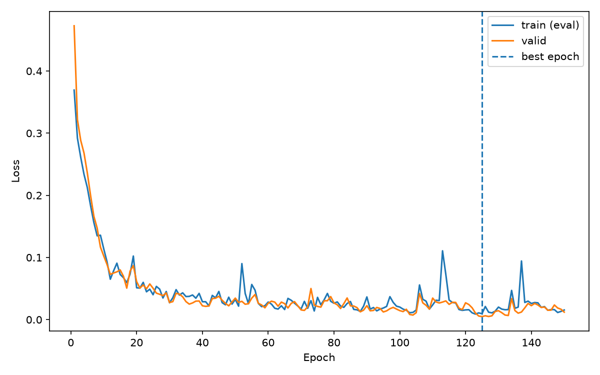

# 07_project.py 분석 리포트

- 분석 대상: [02_응용/07_project.py](../07_project.py)
- 작성일: 2026-10-30
- 자료: 소스 코드, `02_응용/data/points.csv`, `02_응용/outputs/07_*` 결과 파일
- 사용 데이터 : `data/points.csv`
- 분석 방식: 코드와 저장된 결과를 대조했다. 이번 문서 작성 과정에서 모델을 재학습하지는 않았다.

## 1. 목적

이 프로그램은 두 입력 특성으로 클래스 0과 1을 분류하는 신경망을 학습하고, Optimizer·학습률·Dropout 설정에 따른 검증 성능을 비교한다. 각 실험에서 검증 손실이 가장 낮았던 가중치를 복원한 뒤 클래스별 Recall과 개별 예측을 저장한다.

## 2. 데이터 구성

데이터는 스크립트 위치를 기준으로 `data/points.csv`에서 읽는다. 실행한 터미널의 현재 폴더와 무관하게 같은 데이터 경로를 사용한다.

| 열 | 용도 |
| --- | --- |
| `id` | 샘플 식별자, 예측 결과 추적 |
| `x1`, `x2` | 모델에 입력하는 실수 특성 |
| `label` | 정답 클래스 0 또는 1 |
| `split` | train / valid / test 구분 |

| 분할 | 클래스 0 | 클래스 1 | 합계 | 사용 목적 |
| --- | ---: | ---: | ---: | --- |
| train | 120 | 120 | 240 | 파라미터 학습 |
| valid | 40 | 40 | 80 | 최적 epoch 선택 및 성능 비교 |
| test | 40 | 40 | 80 | 코드에서 사용하지 않음 |

입력은 `float32`, 정답은 `long` 텐서로 변환한다.

## 3. 모델 및 실험 조건

기본 모델은 다음과 같은 다층 퍼셉트론이다.

```text
입력 2개
 → Linear(2, 32) → ReLU → Dropout(p)
 → Linear(32, 32) → ReLU → Dropout(p)
 → Linear(32, 2)
 → 클래스별 logits 2개
```

| 실험 이름 | Optimizer | 학습률 | Dropout |
| --- | --- | ---: | ---: |
| `sgd_lr0.1` | SGD | 0.1 | 0.0 |
| `sgd_lr0.05` | SGD | 0.05 | 0.0 |
| `adamw` | AdamW | 0.02 | 0.0 |
| `adamw_dropout` | AdamW | 0.02 | 0.3 |

공통 조건은 150 epoch, 배치 크기 32, 모델 seed 42, DataLoader seed 43이다. 

## 4. 학습·평가 흐름

1. 실험마다 seed를 다시 설정하고 모델과 DataLoader를 생성한다. 같은 구조의 모델은 같은 초기 가중치와 같은 배치 순서로 시작하도록 구성되어 있다.
2. `model.train()`에서 각 배치의 기울기를 초기화하고, 순전파 → 손실 계산 → 역전파 → Optimizer 갱신을 수행한다.
3. epoch 종료 후 `model.eval()`과 `torch.no_grad()`로 전체 train 손실, valid 손실, valid 정확도를 측정한다.
4. valid 손실이 기존 최저값보다 작으면 `copy.deepcopy(model.state_dict())`로 상태를 복사한다.
5. 150 epoch를 모두 학습한 뒤 검증 손실이 최소인 epoch의 상태를 복원한다.
6. 복원 모델의 검증 손실을 재확인하고 클래스별 지표, 예측, 학습곡선을 저장한다.

최적 상태는 깊은 복사로 보관하므로 이후 학습이 저장된 가중치를 덮어쓰지 않는다. 

## 5. 실행 결과

**수치를 비교했을 때, 이번 실험에서는 Dropout을 적용하지 않은 AdamW가 가장 좋았다.** 최저 검증 손실은 0.003392이고, 해당 시점의 검증 정확도는 100%였다.

아래 값은 [07_comparison.csv](../outputs/07_comparison.csv)에 저장된 결과다. 손실은 소수점 여섯 자리로 반올림했다.

| 실험 | 최적 epoch | 최저 검증 손실 | 해당 epoch 정확도 |
| --- | ---: | ---: | ---: |
| SGD, lr 0.1 | 145 | 0.039315 | 97.5% |
| SGD, lr 0.05 | 148 | 0.077482 | 97.5% |
| AdamW | 107 | **0.003392** | **100%** |
| AdamW + Dropout | 125 | 0.004879 | **100%** |

AdamW에 Dropout 0.3을 적용해 보았지만, 최저 검증 손실은 0.003392에서 0.004879로 높아졌다. 두 설정 모두 검증 정확도는 100%였으므로, 최저 검증 손실을 기준으로 보면 이번 실험에서는 Dropout이 없는 쪽이 더 좋아 보인다.

SGD는 성능 수치가 좋지 않아 학습률을 더 크게 주는 방향으로 lr 0.05와 0.1을 비교했다. 손실 곡선에는 값이 크게 튀는 구간이 있지만, lr 0.1의 최저 검증 손실은 0.039315로 lr 0.05의 0.077482보다 낮았다. 두 설정의 검증 정확도는 97.5%로 같으므로, 둘 중에서는 최저 검증 손실이 낮은 lr 0.1이 더 나은 설정으로 보인다.

**네 설정을 종합하면 AdamW가 가장 좋아 보인다.** Dropout 없는 AdamW가 다른 설정보다 낮은 최저 검증 손실과 높은 검증 정확도를 기록했다. 따라서 이번 데이터와 실험 조건에서는 **AdamW, lr 0.02, Dropout 0.0**을 선택하는 것이 적절하다.

학습곡선:








